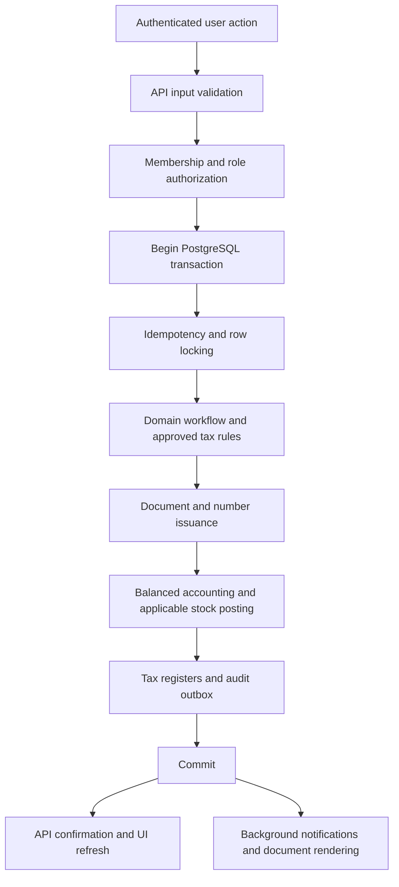

# Bepari — Suggested Repository Structure and Request Flow

## Proposed source structure
```text
bepari/
├─ apps/
│  ├─ web/
│  │  ├─ src/
│  │  │  ├─ app/                 # routes, app providers, i18n
│  │  │  ├─ design-system/       # accessible atoms, typography, layout
│  │  │  ├─ workspaces/          # dashboard/sales/purchases/finance/tax
│  │  │  ├─ features/            # invoice editor, party picker etc.
│  │  │  ├─ api/                 # typed API client
│  │  │  └─ offline/             # non-issued drafts only
│  │  └─ public/
│  └─ api/
│     └─ src/
│        ├─ server.ts            # Hono app + middleware
│        ├─ auth/                # verified identity, membership
│        ├─ modules/
│        │  ├─ organizations/
│        │  ├─ parties/
│        │  ├─ catalog/
│        │  ├─ sales/
│        │  ├─ purchasing/
│        │  ├─ inventory/
│        │  ├─ payments/
│        │  ├─ accounting/
│        │  ├─ tax/
│        │  ├─ recurring/
│        │  ├─ documents/
│        │  ├─ reporting/
│        │  └─ audit/
│        └─ shared/              # errors, decimal, tenant context
├─ packages/
│  ├─ db/                        # Drizzle schema, migrations, seeds
│  ├─ domain/                    # no React/DB-specific domain value objects
│  ├─ contracts/                 # Zod, typed request/response
│  ├─ localization/              # bn/en translation keys
│  └─ testing/                   # fixtures and DB test utilities
├─ docs/
│  ├─ ADR/
│  ├─ PRODUCT_REQUIREMENTS.md
│  ├─ ACCOUNTING_POSTING_MATRIX.md
│  ├─ TAX_RULES_REGISTER.md
│  ├─ API_CONTRACT.md
│  ├─ SECURITY_THREAT_MODEL.md
│  ├─ UX_DESIGN_RULES.md
│  └─ TEST_REPORT.md
├─ .github/workflows/
├─ .env.example
├─ README.md
└─ package.json
```

## Dependency rule
`React UI -> Typed API client -> API controllers -> Domain services -> Transactional persistence`.

- Domain services cannot import React components.
- `tax/` cannot directly mutate money balances; it returns approved determination to posting service.
- `documents/` can render snapshots but never invent business totals.
- `reports/` reads posted financial data; it does not post data.
- `recurring/` submits normal domain commands, not direct insert of independent GL/AR records.
- `audit/` is a cross-cutting transactional capability, not a replaceable frontend array.

## Critical commands and transactions


## Extensibility strategy
1. Each domain owns its state transitions and validation but shares references via stable IDs and DB FKs.
2. Never expose database shape as public API shape; typed DTOs version independently.
3. Add legal rules by effective-dated versions and vetted migrations, not scattered conditionals.
4. Handle external gateways through adapters and webhook inbox/outbox idempotency.
5. Scheduled maintenance/recurring jobs must be resumable and observable.
6. Use feature flags + permission checks for optional modules instead of rendering every feature to every business.
7. Start as one deployable unit, split jobs/workers only when measured workload justifies it.

## Primary metrics
- Time to first real invoice, successful invoice issue ratio, failed post ratio, average taps per receipt, customer statement completion time, reconciliation exceptions, number of VAT rule review blockers, support escalations per 100 active businesses.
- Business KPI values from real data only; no 'fake growth percentage' on dashboard.
